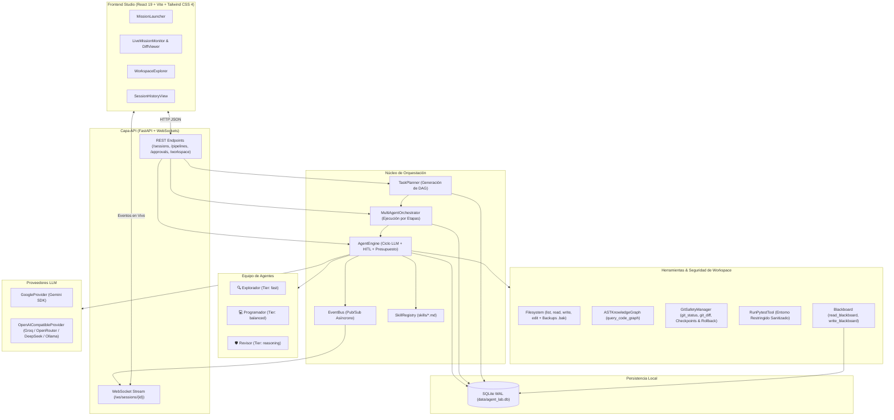

# 🧪 AGENT LAB — Multi-Agent Software Engineering Studio


**AGENT LAB** es una plataforma local de orquestación multi-agente para ingeniería de software asistida por IA, diseñada con control **Human-in-the-Loop (HITL)**, aislamiento no destructivo mediante **Git Checkpoints**, indexación estática **AST Knowledge Graph**, memoria compartida (**Blackboard**) y contabilidad de costos/tokens en tiempo real.

---

## ✨ Características Principales

- **Orquestación Multi-Agente Flexible (`auto`, `pipeline`, `single`)**
  - **Planificador IA (`TaskPlanner`)**: Descompone dinámicamente el objetivo del usuario y el estado del workspace en un pipeline secuencial de 1 a 4 etapas validado con esquemas JSON.
  - **Pipeline Reanudable (`MultiAgentOrchestrator`)**: Coordina múltiples agentes especialistas que colaboran secuencialmente compartiendo presupuesto y contexto.
  - **Ejecución Directa (`AgentEngine`)**: Permite delegar tareas puntuales a un agente individual.
- **Human-in-the-Loop (HITL) con Vista Previa de Diff y Verificación SHA-256**
  - Las herramientas con nivel de riesgo `moderate` (`write_file`, `edit_file`) o `critical` (`run_pytest`) pausan automáticamente la ejecución y emiten un evento `APPROVAL_REQUIRED`.
  - **Simulación en Memoria**: Genera un *unified diff* en memoria antes de tocar el disco y registra el hash `SHA-256` del archivo objetivo. Si el archivo fue modificado externamente mientras esperaba aprobación, bloquea la escritura para evitar pisar cambios manuales.
- **Seguridad Git No Destructiva (`GitSafetyManager`)**
  - Crea automáticamente una rama dedicada por misión (`agentlab/mission-<id>`) y preserva el estado sucio previo (*staged*, *unstaged* y *untracked*) en la base de objetos de Git (`git hash-object -w`).
  - **Rollback Selectivo**: Revierte únicamente los archivos creados o modificados por los agentes sin utilizar comandos destructivos (`git reset --hard` ni `git clean -fd`), bloqueando el rollback si detecta ediciones manuales posteriores del usuario.
-**Grafo Estructural de Código (`ASTKnowledgeGraph`)**
  - Indexa módulos Python (`.py`) mediante análisis estático AST (clases, herencia, funciones síncronas/asíncronas, firmas tipadas, líneas e imports) sin consumir tokens LLM.
- **Blackboard Compartido y Sistema de Skills Modulares**
  - **Blackboard**: Pizarra clave-valor persistida en SQLite para que los agentes publiquen diagnósticos, planes y auditorías entre etapas.
  - **Skills Dinámicas (`skills/*.md`)**: Inyección automática de guías operativas en el *system prompt* según palabras clave de la misión o configuración por defecto del agente (`pytest_tdd`, `python_clean_code`, `security_audit`).
- **Enrutamiento Multi-Proveedor por Tiers (`fast`, `balanced`, `reasoning`)**
  - Soporte nativo para **Google Gemini** (`google-genai`) y adaptador universal **OpenAI-Compatible** para **Groq**, **OpenRouter**, **DeepSeek** y **Ollama** (ejecución 100% local).
  - Reintentos automáticos con *exponential backoff* y lectura de cabeceras `Retry-After` ante errores `429`/`503`.
-  **Libro Mayor de Tokens (`TokenLedger`) y Recuperación de Sesiones**
  - Registro contable *append-only* por paso con cálculo de costo estimado en USD (incluyendo descuento por tokens en caché y costo `$0.00` para modelos `:free` o `ollama`) y control estricto de presupuesto máximo por sesión.
  - Reconciliación automática al iniciar el servidor: marca sesiones interrumpidas como `interrupted` y permite reanudarlas de forma idempotente desde la etapa exacta en que quedaron.
- ⚡ **Telemetría en Tiempo Real vía WebSockets**
  - Bus de eventos asíncrono (`EventBus`) conectado a `SessionConnectionManager` con *replay* automático del historial de eventos al reconectar clientes.

---

## Arquitectura del Sistema



---

## Equipo de Agentes y Herramientas

### Agentes Registrados por Defecto

| ID | Nombre | Rol | Tier de Modelo | Herramientas Permitidas | Skills por Defecto |
| :--- | :--- | :--- | :---: | :--- | :--- |
| `explorador` | Agente Explorador | Analista de Repositorio | `fast` | `list_files`, `read_file`, `query_code_graph`, `git_status`, `git_diff`, `run_pytest`, `read_blackboard`, `write_blackboard` | `security_audit` |
| `programador` | Agente Programador | Ingeniero de Software | `balanced` | `list_files`, `read_file`, `write_file`, `edit_file`, `run_pytest`, `read_blackboard`, `write_blackboard` | *(Dinámicas por prompt)* |
| `revisor` | Agente Revisor | Auditor de Calidad y Seguridad | `reasoning` | `list_files`, `read_file`, `query_code_graph`, `git_status`, `git_diff`, `run_pytest`, `read_blackboard`, `write_blackboard` | `security_audit` |

### Catálogo de Herramientas y Niveles de Riesgo

| Herramienta | Nivel de Riesgo | Requiere HITL | Descripción |
| :--- | :---: | :---: | :--- |
| `list_files` | `safe` | No | Lista archivos y carpetas del workspace ignorando `.git`, `.venv`, `node_modules`, `.agentlab` y secretos. |
| `read_file` | `safe` | No | Lee contenido UTF-8 de un archivo dentro del workspace (truncado seguro a 20,000 caracteres). |
| `query_code_graph` | `safe` | No | Consulta el mapa estructural AST de módulos Python (clases, firmas, líneas e imports). |
| `git_status` | `safe` | No | Muestra la rama activa y el resumen de estado del repositorio Git del workspace. |
| `git_diff` | `safe` | No | Devuelve el diff unificado de cambios *staged*, *unstaged* y archivos nuevos *untracked*. |
| `read_blackboard` | `safe` | No | Lee una clave específica o todas las entradas publicadas en la memoria compartida de la sesión. |
| `write_blackboard` | `safe` | No | Publica hallazgos o diagnósticos en la pizarra compartida de la sesión activa. |
| `write_file` | `moderate` | **Sí** | Crea o sobrescribe un archivo generando vista previa de diff, validación SHA-256 y backup en `.agentlab/backups/`. |
| `edit_file` | `moderate` | **Sí** | Reemplaza un bloque único y exacto de texto en un archivo existente con vista previa de diff y backup previo. |
| `run_pytest` | `critical` | **Sí** | Ejecuta `pytest` con timeout de 30s bajo un entorno de variables sanitizado (`build_restricted_env`, sin claves API). |

---

## Estructura del Proyecto

```text
AGENTLAB/
├── backend/
│   ├── agents/
│   │   ├── engine.py          # Motor de ejecución de agentes, ciclo tool-calling y pausa HITL
│   │   ├── orchestrator.py    # Orquestador multi-agente secuencial y reanudación de sesiones
│   │   ├── planner.py         # Planificador IA que genera etapas DAG dinámicas con fallback seguro
│   │   ├── registry.py        # Registro central de configuraciones AgentConfig
│   │   └── schemas.py         # Modelos Pydantic: AgentConfig, TaskSession, AgentRun
│   ├── api/
│   │   ├── dependencies.py    # Inyección de dependencias (AppContainer, registro de agentes y tools)
│   │   ├── main.py            # Aplicación FastAPI, endpoints REST y endpoint WebSocket
│   │   └── ws.py              # Gestor de conexiones WebSocket por sesión con replay de eventos
│   ├── core/
│   │   ├── config.py          # Resolución de rutas de modelos por tier (proveedor:modelo)
│   │   ├── events.py          # EventBus asíncrono y esquema inmutable SystemEvent
│   │   ├── pricing.py         # Tabla de tarifas por millón de tokens y estimador de costos USD
│   │   └── skills.py          # Cargador y selector dinámico de skills desde archivos Markdown
│   ├── providers/
│   │   ├── base.py            # Contrato abstracto BaseProvider
│   │   ├── google.py          # Adaptador oficial para Google Gemini (google-genai)
│   │   ├── openai_compat.py   # Adaptador universal para Groq, OpenRouter, DeepSeek y Ollama
│   │   └── schemas.py         # DTOs agnósticos: Message, ToolCall, ToolDefinition, LLMResponse
│   ├── storage/
│   │   ├── database.py        # Gestor SQLite en modo WAL e inicialización/migración de esquema
│   │   ├── repository.py      # Operaciones CRUD para sesiones, runs, mensajes, tools y TokenLedger
│   │   └── schemas.py         # Esquema contable TokenLedgerEntry
│   └── tools/
│       ├── base.py            # Contrato abstracto BaseTool con validación Pydantic automática
│       ├── blackboard.py      # Herramientas read_blackboard y write_blackboard
│       ├── execution.py       # Herramienta run_pytest con entorno de variables restringido
│       ├── filesystem.py      # Herramientas list_files, read_file, write_file y edit_file
│       ├── git_ops.py         # GitSafetyManager, checkpoints, rollback no destructivo y diff preview
│       ├── knowledge_graph.py # Analizador estático ASTKnowledgeGraph y query_code_graph
│       ├── registry.py        # Registro central de herramientas y filtro por agente
│       ├── schemas.py         # Modelos ToolResult y ToolExecution
│       └── workspace.py       # WorkspaceManager: prevención de path traversal, bloqueo de secretos y backups
├── frontend/
│   ├── src/
│   │   ├── components/
│   │   │   ├── DiffViewer.tsx         # Renderizador de diffs unificados con resaltado +/-
│   │   │   ├── LiveMissionMonitor.tsx # Panel en vivo: etapas, aprobación HITL, logs WS, Blackboard y rollback
│   │   │   ├── MissionLauncher.tsx    # Lanzador de misiones con selector de estrategia y plantillas rápidas
│   │   │   ├── SessionHistoryView.tsx # Historial de misiones, KPIs de éxito y consumo acumulado en USD
│   │   │   └── WorkspaceExplorer.tsx  # Explorador y visor de archivos del workspace en solo lectura
│   │   ├── api.ts             # Cliente HTTP/WS tipado hacia el backend FastAPI
│   │   └── App.tsx            # Layout principal del estudio AGENT LAB
│   ├── package.json
│   └── vite.config.ts
├── skills/                    # Habilidades modulares en Markdown con frontmatter de triggers
│   ├── pytest_tdd.md
│   ├── python_clean_code.md
│   └── security_audit.md
├── tests/                     # Suite completa de pruebas unitarias e integración (v0.2 a v0.9)
├── data/                      # Base de datos SQLite (agent_lab.db) y workspaces aislados
├── dev.ps1                    # Script PowerShell para levantar Backend + Frontend en desarrollo
├── start.ps1                  # Script PowerShell para iniciar servicios y abrir el navegador
├── requirements.txt           # Dependencias de Python
└── pyproject.toml             # Configuración de Pytest
```

---

## Requisitos e Instalación

### Prerrequisitos
- **Python** `3.11+`
- **Node.js** `20+` y `npm`
- **Git** instalado y disponible en el `PATH` (para checkpoints y aislamiento por ramas)

### 1. Configurar el Entorno Backend (Python)

```powershell
# Crear y activar el entorno virtual en la raíz del proyecto
python -m venv .venv
.\.venv\Scripts\Activate.ps1

# Instalar dependencias principales y cliente HTTP asíncrono
pip install -r requirements.txt
pip install httpx
```

### 2. Instalar Dependencias del Frontend (React + Vite)

```powershell
cd frontend
npm install
cd ..
```

---

## ⚙️ Configuración de Variables de Entorno (`.env`)

Crea un archivo `.env` en la raíz del proyecto. Puedes combinar distintos proveedores y modelos en cada *tier* utilizando la sintaxis `proveedor:modelo` (`google`, `groq`, `openrouter`, `deepseek`, `ollama`):

```ini
# Proveedor por defecto cuando no se especifica prefijo en el tier
DEFAULT_PROVIDER=google

# Rutas por Tier Lógico (acepta "modelo" o "proveedor:modelo")
MODEL_TIER_FAST=gemini-2.5-flash
MODEL_TIER_BALANCED=gemini-2.5-flash
MODEL_TIER_REASONING=gemini-2.5-pro

# Ejemplos alternativos multi-proveedor:
# MODEL_TIER_FAST=groq:llama-3.3-70b-versatile
# MODEL_TIER_BALANCED=openrouter:deepseek/deepseek-chat:free
# MODEL_TIER_REASONING=deepseek:deepseek-reasoner
# MODEL_TIER_FAST=ollama:qwen2.5-coder:7b

# Claves API (configura únicamente las de los proveedores que utilices)
GEMINI_API_KEY=tu_clave_de_google_gemini
GROQ_API_KEY=tu_clave_de_groq
OPENROUTER_API_KEY=tu_clave_de_openrouter
DEEPSEEK_API_KEY=tu_clave_de_deepseek

# URL opcional para Ollama local (por defecto http://localhost:11434/v1)
OLLAMA_BASE_URL=http://localhost:11434/v1
```

---

## Ejecución del Proyecto

### Opción A: Inicio Rápido con Scripts PowerShell (Windows)

Para levantar simultáneamente el backend FastAPI (`http://127.0.0.1:8000`) y el servidor de desarrollo Vite (`http://localhost:5173`):

```powershell
# Inicia ambos servidores en la misma terminal
.\dev.ps1

# O inicia ambos servidores y abre automáticamente http://localhost:5173 en tu navegador
.\start.ps1
```

### Opción B: Inicio Manual en Dos Terminales

**Terminal 1 — Backend (FastAPI):**
```powershell
.\.venv\Scripts\python.exe -m uvicorn backend.api.main:app --reload --reload-dir backend --port 8000
```

**Terminal 2 — Frontend (Vite):**
```powershell
cd frontend
npm run dev
```

- **Interfaz Web (Studio)**: `http://localhost:5173`
- **Documentación Interactiva OpenAPI (Swagger)**: `http://127.0.0.1:8000/docs`

---

## Referencia Rápida de la API

| Método | Endpoint | Descripción |
| :---: | :--- | :--- |
| `GET` | `/health` | Estado del servidor, versión, agentes registrados y herramientas activas. |
| `GET` | `/workspace/files` | Lista todos los archivos permitidos dentro del `workspace_path` indicado. |
| `GET` | `/workspace/file` | Lee el contenido de un archivo relativo al workspace de forma segura. |
| `GET` | `/sessions` | Lista las últimas sesiones, aprobaciones HITL pendientes y costo total en USD. |
| `POST` | `/sessions` | Ejecuta una sesión de agente único de manera síncrona. |
| `POST` | `/sessions/async` | Programa una sesión de agente único en segundo plano y devuelve `ws_url`. |
| `POST` | `/pipelines/auto` | Invoca al `TaskPlanner` (con `ASTKnowledgeGraph` opcional) y ejecuta el pipeline en segundo plano. |
| `POST` | `/pipelines/async` | Ejecuta un pipeline multi-agente definido manualmente en segundo plano. |
| `POST` | `/pipelines` | Ejecuta un pipeline multi-agente de forma síncrona. |
| `GET` | `/sessions/{session_id}` | Obtiene el estado completo de la sesión, `runs`, aprobaciones pendientes y costo USD. |
| `GET` | `/sessions/{session_id}/messages` | Devuelve el historial secuencial de mensajes (`user`, `assistant`, `tool`) de la sesión. |
| `POST` | `/approvals/{execution_id}` | Aprueba (`{"approved": true}`) o rechaza (`{"approved": false}`) una herramienta pausada en HITL y reanuda el flujo. |
| `POST` | `/sessions/{session_id}/rollback` | Ejecuta un rollback selectivo y no destructivo del checkpoint Git de la misión. |
| `POST` | `/sessions/{session_id}/resume` | Reanuda de forma segura e idempotente una sesión marcada como `interrupted`. |
| `DELETE` | `/sessions/{session_id}` | Elimina una sesión específica y sus registros asociados en SQLite. |
| `DELETE` | `/sessions` | Limpia todas las sesiones finalizadas del historial (preserva sesiones en ejecución). |
| `WS` | `/ws/sessions/{session_id}` | Canal WebSocket en tiempo real con replay de eventos (`SESSION_STARTED`, `RUN_STARTED`, `TOOL_CALLED`, `APPROVAL_REQUIRED`, `TOKEN_RECORDED`, etc.). |

---

## Pruebas Automatizadas

El proyecto cuenta con una suite exhaustiva de pruebas con **Pytest** que valida cada subsistema (motor de ejecución, API HITL, Blackboard multi-agente, WebSockets, proveedores, cálculo de precios, ejecución de pytest restringida, planificador IA, pipelines reanudables, grafo AST, skills y seguridad Git):

```powershell
# Ejecutar toda la suite de tests
.\.venv\Scripts\python.exe -m pytest -v
```

---

## Mecanismos de Seguridad Integrados

1. **Aislamiento de Rutas (`WorkspaceManager`)**: Bloquea cualquier intento de *path traversal* (`../`) fuera de la carpeta del workspace asignado, así como lecturas o escrituras sobre archivos sensibles (`.env`, `.env.*`, `id_rsa`, `id_ed25519`, `*.pem`, `*.key`, `*.p12`, `*.pfx`, `.git/` y `.agentlab/`).
2. **Copias de Seguridad Automáticas**: Antes de cualquier `write_file` o `edit_file` sobre un archivo existente, se almacena una copia con marca de tiempo UTC en `.agentlab/backups/<archivo>.<timestamp>.bak`.
3. **Verificación de Integridad HITL**: Cada solicitud de modificación calcula el hash `SHA-256` del archivo al generar la vista previa del diff y lo verifica nuevamente en el instante en que el usuario hace clic en **Aprobar y Ejecutar**.
4. **Subprocesos con Entorno Sanitizado**: La herramienta `run_pytest` filtra `os.environ` mediante una lista blanca estricta de variables de sistema y elimina cualquier variable cuyo nombre contenga `KEY`, `SECRET`, `TOKEN`, `PASSWORD`, `CREDENTIAL` o `AUTH`.

